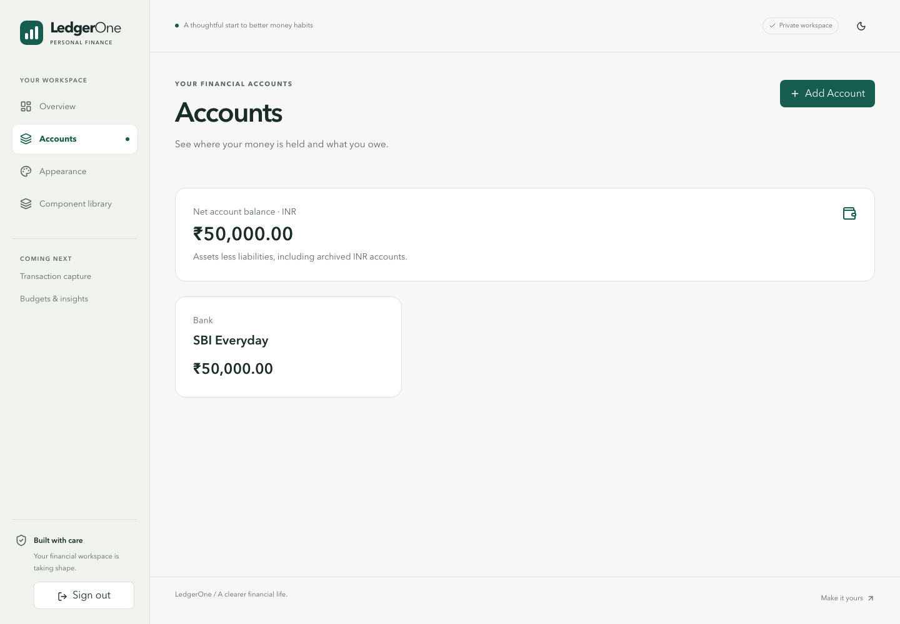
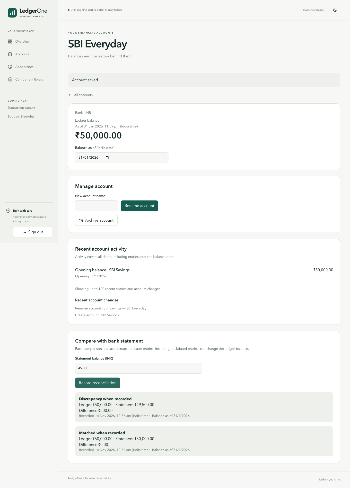

# S07 actual application walkthrough

These screenshots come from the real Next application with a verified synthetic owner session, a disposable local PostgreSQL database and a restricted typed account writer. They contain demo data only. The native generic financial endpoint remained disabled.

1. Open Accounts and use Add Account to create INR SBI Savings with a ₹50,000 opening on 1 January 2026. Review and confirm the amount. Refreshing preserves ₹50,000.
2. Inspect the opening activity. Rename to SBI Everyday. The activity still reads “Opening balance · SBI Savings”.
3. Select 31 January 2026 and record a ₹49,500 statement. The immutable reconciliation shows ledger ₹50,000, statement ₹49,500 and discrepancy ₹500.
4. Archive and restore through the UI. A separate signed-in owner gets no account details and cannot rename the account. Forged internal fields and raw POST input are rejected. Main-content accessibility checks pass on desktop/mobile.

| View                                                 | Desktop                               | Mobile                               |
| ---------------------------------------------------- | ------------------------------------- | ------------------------------------ |
| Owned accounts and exact balance                     | [Overview](desktop-overview.png)      | [Overview](mobile-overview.png)      |
| Renamed account, original opening and reconciliation | [Details](desktop-reconciliation.png) | [Details](mobile-reconciliation.png) |

Mobile screenshots are linked in the table to keep the walkthrough compact. The corresponding browser test is tests/e2e/accounts.spec.ts. Full local result is 234 unit / 281 integration / 50 browser, recorded in the S07 report. Hosted verification, production writes and reviewed merge remain separate gates.

## Presentation review delta

Statement comparison is below recent activity. Balance-as-of selection sits beside the balance. The browser test selects a cutoff before the opening and verifies a zero historical balance while the later opening remains clearly labeled as all-date activity. Saved comparisons show both their recorded time and effective balance date, with “when recorded” status labels. The updated desktop/mobile detail screenshots include both a matched snapshot and a discrepancy snapshot.
