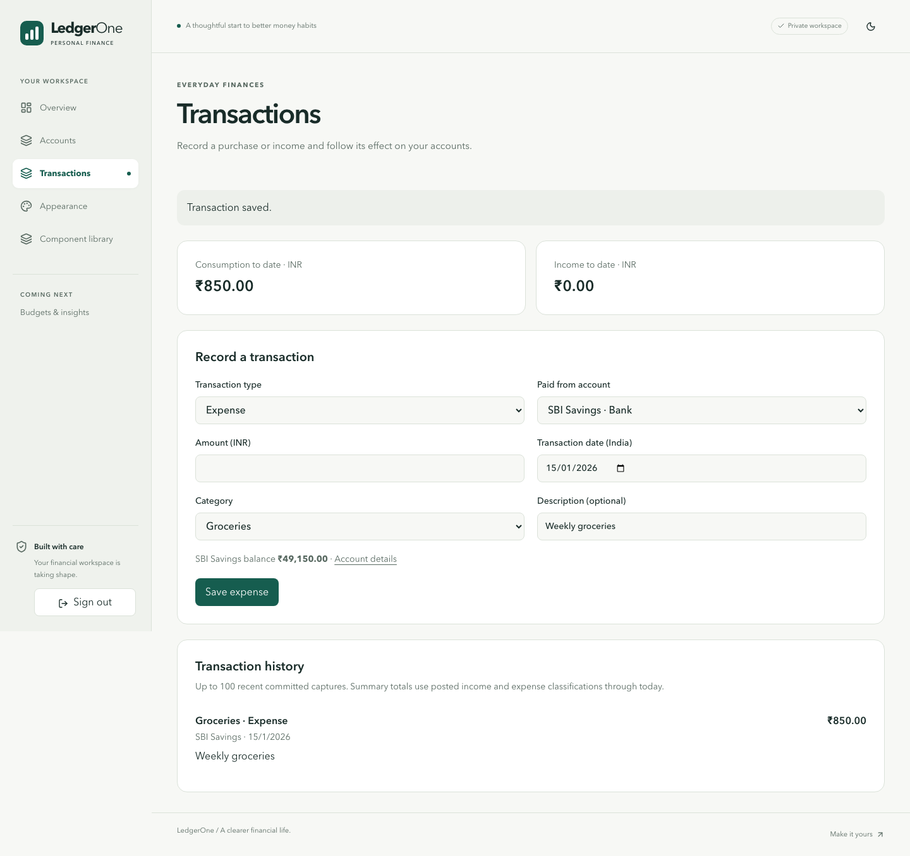
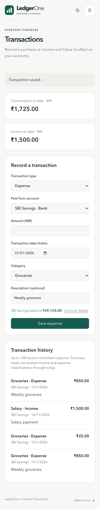
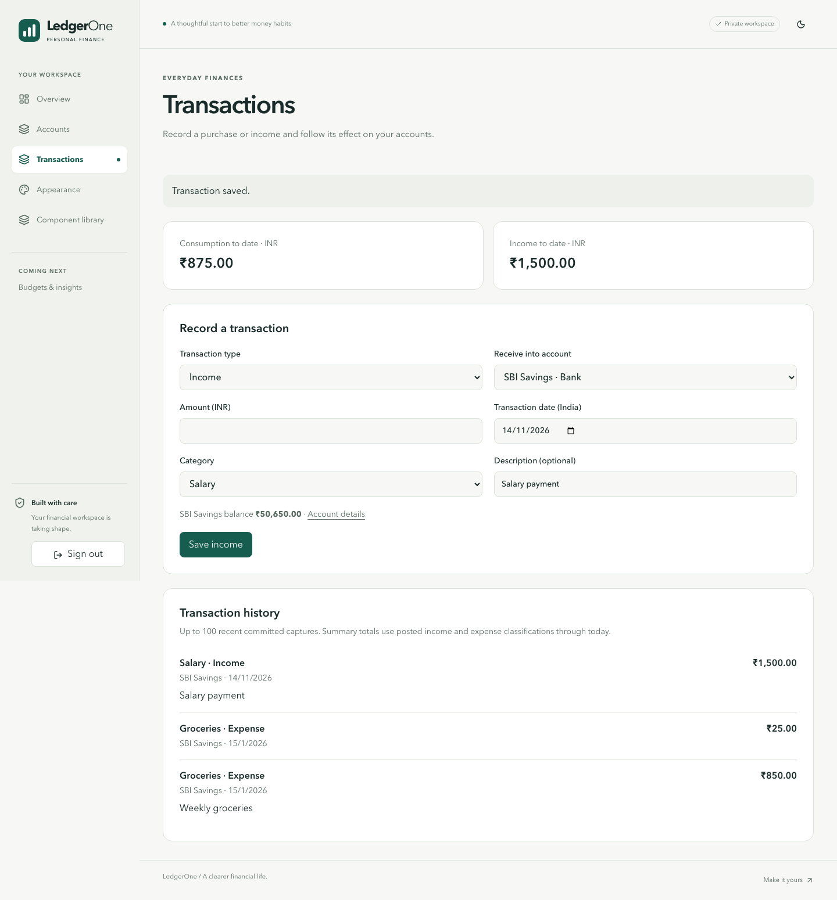
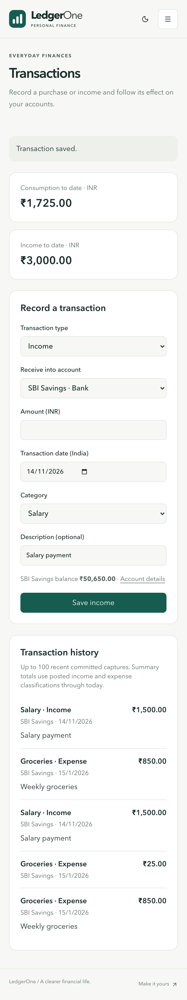

# P1-S08-A — Expense and income UI delivery

Status: S08-A local implementation and full pipeline PASS; owner independent review and merge pending. Parent S08 #38 / P1-E4 #37 remain open. Base is the verified S07 merge `1fd3b936a3ccdce2194bc5b6be2fa769acaa0318`.

## Working result

Real authenticated `/transactions` supports BANK/CASH expenses, CREDIT_CARD purchases and BANK/CASH income, with positive exact INR amounts, India effective date, approved classification choices and optional description. It saves through typed server-derived templates and the existing shared financial executor, then reloads real balances/history. Empty/loading/error/success states and same-key lost-response recovery are included.

Desktop/mobile tests establish SBI Savings opening ₹50,000 → ₹850 Groceries → ₹49,150 after refresh → ₹1,500 Salary → ₹50,650. Accessibility assertions pass. The lost-acknowledgement test commits the real request, aborts its response, rejects changed-input resubmission and recovers the identical single operation/audit. Screenshots are synthetic fixture data, not real personal transactions. Tests run concurrently against one test owner, so summary/history screenshots can include other test-created accounts/captures; per-account balances and operation identities are independently asserted.

| Desktop                                                    | Mobile                                                    |
| ---------------------------------------------------------- | --------------------------------------------------------- |
|  |  |
|    |    |

## Source and migration

- `transactions/contract.ts`, `shared.ts`, `template.ts`: strict business payloads, owner/workspace canonical hash, eligible account checks and server-derived canonical POST legs; controlled audit reasons.
- `ledger/commands/executor.ts`: typed normalization and immutable capture replay inside the existing authorization/attestation/locking/retry/deadline/COMMIT/ROLLBACK path; no second runner.
- `transactions/http.ts`, `server.ts`, `/api/transactions`: actual session-derived ownership, CSRF-aware POST, bounded body validation, restricted typed capability and scoped read/history/consumption.
- Transaction component/pages/navigation: persisted form, balances, history, categories and recovery.
- Additive migration `202611140010_transaction_capture`, Prisma model and schema version10: immutable scoped capture evidence with deferred exact two-leg POST/audit binding. Existing migrations001–009 are byte-identical to merged main. No published runtime grant or existing trigger/function was modified. Existing fresh/private upgrade/zero-drift/catalog tests remain applicable.
- Only disposable local fixture grants gain SELECT/INSERT on transaction_record. Default native typed writes remain unavailable outside the explicitly provisioned local test app; generic financial commands remain unavailable in native routes.

Recovery: keep writes disabled, retain migration and all committed accounting evidence, revert application code if needed. No destructive data rollback. No hosted migration/operation occurred.

## Verification

Environment: macOS arm64, Node22.23.5/npm10.9.9, native PostgreSQL17.6 at loopback port55454; generated disposable test databases, actual restricted writers, public/private schemas, existing verified allowlisted synthetic sessions. No shared-Docker qualification or capacity campaign was repeated. No hosted database was contacted.

Targeted commands actually executed:

- `npm run test:unit -- src/lib/transactions/contract.test.ts`: 11 PASS.
- `npm run test:integration -- tests/integration/transaction-capture.test.ts`: initial18 PASS, expanded22 PASS, then24 PASS (the final pipeline includes the additional actual USD-account rejection assertion).
- `node_modules/.bin/playwright test tests/e2e/transactions.spec.ts`, under `withFreshLedgerDatabase` after generate/migrate/typecheck/build: 4 PASS, desktop/mobile.
- `git diff --check`: PASS. Python byte comparison and SHA256 against merged main: all nine historical migrations unchanged.

The standard pipeline runs on a fresh generated database using `withFreshLedgerDatabase`; each stage fails fast. Reproduction (provide a local disposable-control PostgreSQL URL, never hosted credentials):

```sh
LEDGERONE_ENV=test TEST_DATABASE_URL='<loopback-only *_test database URL>' node --import tsx --input-type=module <<'JS'
import { spawnSync } from 'node:child_process';
import { withFreshLedgerDatabase } from './scripts/lib/fresh-ledger-database.ts';
await withFreshLedgerDatabase(process.env.TEST_DATABASE_URL, async url => {
  const env = {...process.env, LEDGERONE_ENV:'test', DATABASE_URL:url, DIRECT_DATABASE_URL:url, TEST_DATABASE_URL:url};
  for (const stage of ['db:generate','db:migrate:test','format:check','lint','typecheck','test:unit','test:integration','test:schema','ledger:attest','build','test:e2e']) {
    const result = spawnSync('npm',['run',stage],{env,stdio:'inherit'});
    if (result.status !== 0) throw new Error(stage+' failed');
  }
  const result = spawnSync('python3',['scripts/check_foundation.py'],{env,stdio:'inherit'});
  if (result.status !== 0) throw new Error('foundation failed');
});
JS
```

Final pipeline at implementation source `552c0298938d8b58d7227233bc6bb3b0e9f0a627`: generate/migrate, formatting, lint, typecheck, **245 unit / 305 integration / 56 browser PASS**, fresh private-schema/upgrade/zero-drift checks, read-only production-grant rehearsal, invariant attestation, build and foundation checks PASS. Pipeline exit0. [Complete local output](../evidence/s08-a/local-pipeline.txt) and [source fingerprint](../evidence/s08-a/source-fingerprint.json). Both exact-head GitHub workflows are required after publication; their result will be linked on the PR rather than inferred from these local tests.

## Development failures retained

The initial integration import pulled the native Next/auth module into Vitest; separating the native wrapper from the dependency-injected real handler corrected it. Manual template leg order initially conflicted with the shared semantic verifier; the template now uses existing parsePost canonicalization rather than changing the verifier. The first browser run attempted a second owner workspace and used an exact nested-label selector; the fixture now reuses/recovers the existing owned workspace and selects the accessible category combobox. A first standard pipeline failed lint for an unused response variable; corrected without behavior change. These failed runs are not reported as passing evidence.

## Limits and next slice

This is S08-A, not complete S08 or Phase1. S08-B transfers/card payments, S08-C FD/loan principal-interest and S08-D combined history/consumption acceptance remain required in that order. No merchant/tag/category CRUD, budgets, analytics platform, FX or S08 correction UI is added. History currently shows latest100 captured expense/income operations with original snapshots and reversal flag; current summaries derive from all effective posted classification legs. Consumer correction/reversal controls remain unexposed, while existing linked-journal engine semantics and reports are retained and tested.

Pending browser recovery identity currently lasts for the mounted page; refreshing during an unknown outcome requires checking committed history before creating a fresh request. It is not a durable browser outbox. Classification defaults are a small initial approved-choice list, not the Phase2 taxonomy editor.

Owner independent review is pending; no generalized agent review, human security certification or native GitHub approval is claimed. #16/#17, original residual S07 requirements, Docker #34 and bounded minimatch alert retain their existing status. P1-E3/Phase1 remain incomplete; hosted verification NOT RUN, production/default financial activation disabled. No merge authorized.
